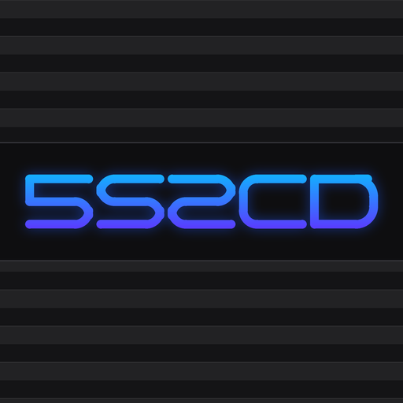

<p align="center"></p>

<h1 align="center">5S2CD</h1>

<p align="center"><b>Play your own PlayStation 2 game discs on a jailbroken PS5.</b><br>
Put the disc in the PS5's drive or a USB DVD drive, pick it on the shelf, play.</p>

---

5S2CD is a fork of **[PS5SX2](https://github.com/Swordpdf/PS5SX2)** by **swordpdf**, the PCSX2 port for the PS5.
All the emulation, the shelf and the settings are PS5SX2's work; 5S2CD adds reading **real discs** and a few shelf
extras, and installs as its own app next to PS5SX2 (title ID `PPSA99213`), sharing PS5SX2's BIOS, memory cards and
settings.

> Based on PS5SX2 **vk-285-139**. The original PS5SX2 readme is kept as [README-PS5SX2.md](README-PS5SX2.md).

## What it adds

- **Real discs** - PS2 DVDs and CDs in the PS5's own drive (`/dev/cd0`) or a USB DVD drive (`/dev/cd1`). Each drive
  sits first on the shelf with the game's name and cover as soon as a disc is in.
- **Disc tiles on the home screen** *(optional, `discwatch.elf`)* - insert a disc and a tile with the game's name and
  cover appears on the PS5 home screen; open it and the game boots straight from the disc. Take the disc out and the
  tile goes away. One tile per drive; nothing starts by itself.
- **Favourites** - press **L3** on the shelf to mark a game; favourites come first, with a badge.
- **Shelf tabs** - **Circle** switches between *All*, *Disc drives*, *Favorites* and *Disc images*.
- **Covers for discs** - downloaded by the disc's serial, like PS5SX2 does for images.
- A darker shelf background. Your disc images (ISO, CHD, CSO...) still work as in PS5SX2.

**Limits:** CD audio tracks play as silence (the PS5's disc driver can't read audio sectors), the PS5's own drive
loads a little slower than a USB drive, and *back to the menu* restarts the app (with `relaunch.elf`) instead of
returning instantly.

## Requirements

- A **jailbroken PS5** with a payload loader (`elfldr` on port 9021) and a HEN that can let apps out of their
  sandbox (the same setup PS5SX2 needs). Tested on firmware **13.00**.
- **[PS5SX2](https://github.com/Swordpdf/PS5SX2/releases)** installed and working (with the BIOS dumped from your own
  console) - 5S2CD uses its system module and its `/data/PCSX2` folder.
- **ShadowMountPlus** to register the app (and the disc tiles).
- A PS5 with a **disc drive**, or a **USB DVD drive**.

## Install

1. Download **`5S2CD-v1.0.zip`** from the [Releases](../../releases) page and unzip it.
2. With a file manager on the PS5, copy the zip's `PPSA99213` folder to `/data/homebrew/` (it holds `eboot.bin` and
   `sce_sys` with 5S2CD's name, icon and background).
3. Copy the `sce_module` folder of PS5SX2 (`/data/homebrew/PPSA99203/sce_module`) into `/data/homebrew/PPSA99213/`.
4. Copy `relaunch.elf` to `/data/PCSX2/relaunch.elf`.
5. Allow `PPSA99213` out of the sandbox wherever you allowed PS5SX2 (`PPSA99203`), for example your HEN's app list or
   `/data/whitelist.txt`.
6. Let ShadowMountPlus pick up the app (rescan, or restart the PS5). **5S2CD** appears on the home screen.
7. *Optional:* send `discwatch.elf` with your payload loader (or add it to autoload) for the home-screen disc tiles.
   *Nicer tile art (optional):* get a free API key from [SteamGridDB](https://www.steamgriddb.com/profile/preferences/api)
   and save it in a text file on the PS5 at `/data/PCSX2/disc-tiles/steamgriddb-key.txt`. The tiles then also use
   SteamGridDB's backgrounds and logos. Your key stays on your console; without it the tiles use the disc's cover.

## Use

Put a PS2 disc in, open **5S2CD**: the drive is the first tile on the shelf, with the game's name and cover. Press
**X** to play. Everything else - settings, memory cards, save states, the in-game menu - works as in PS5SX2.

## Build from source

Linux (Ubuntu 22.04 or WSL), clang/lld 18, the [ps5-payload-dev SDK](https://github.com/ps5-payload-dev/sdk) and
PS5SX2's public RADV dependencies (see `ps5/docs/build-dependencies.md`):

```sh
PS5_PAYLOAD_SDK=/path/to/ps5-payload-sdk ps5/5s2cd/tools/build-deps.sh   # once
ps5/5s2cd/tools/build-5s2cd.sh                                           # -> ps5/build-radv/app/eboot.bin
PS5_PAYLOAD_SDK=/path/to/ps5-payload-sdk ps5/5s2cd/relaunch/build.sh      # -> relaunch.elf
PS5_PAYLOAD_SDK=/path/to/ps5-payload-sdk ps5/5s2cd/discwatch/build.sh     # -> build/discwatch.elf
```

What changed against PS5SX2:

| Part | Files |
| --- | --- |
| Disc reader (FreeBSD `cd(4)`: DVD layout, CD TOC, 2048-byte reads, read-ahead) | `ps5/coreorbis/orbis-shims/ProsperoDisc.cpp`, `ProsperoCDVD.cpp` |
| Drives on the shelf, favourites, tabs, covers, darker background | `ps5/frontend/fe_app.*`, `fe_games.*`, `fe_options.cpp`, `fe_covers.cpp`, `fe_ps5.cpp` |
| Disc boot, disc tiles, back to the menu via `relaunch.elf`, title ID `PPSA99213` | `ps5/coreorbis/main-boot.cpp`, `ProsperoHenJailbreak.cpp` |
| App identity (name, icon, background; no music) | `ps5/5s2cd/sce_sys/` |
| Home-screen disc tiles | `ps5/5s2cd/discwatch/` |
| Relaunch helper | `ps5/5s2cd/relaunch/` |

## Credits

- **[PS5SX2](https://github.com/Swordpdf/PS5SX2)** by **swordpdf** - the PS5 port this is built on. Please support
  and star the original.
- **[PCSX2](https://github.com/PCSX2/pcsx2)** and its team - the emulator; the disc reader follows PCSX2's own
  FreeBSD/macOS `IOCtlSrc`.
- **[xlenore/ps2-covers](https://github.com/xlenore/ps2-covers)** - the covers.
- **ShadowMountPlus** - app and tile registration on the home screen.
- **[ps5-payload-dev SDK](https://github.com/ps5-payload-dev/sdk)**, **[stb_image](https://github.com/nothings/stb)**,
  **[Mbed TLS](https://github.com/Mbed-TLS/mbedtls)**.

Made with the help of an AI assistant (Claude by Anthropic).

## License

GPL-3.0 like PCSX2 and PS5SX2 (see [COPYING.GPLv3](COPYING.GPLv3)).

*5S2CD is an unofficial homebrew project, not affiliated with or endorsed by Sony Interactive Entertainment or the
PCSX2 project. No BIOS, system files or games are included: use your own console's BIOS and discs you own.
"PlayStation", "PS2" and "PS5" are trademarks of Sony Interactive Entertainment Inc. Use at your own risk.*
